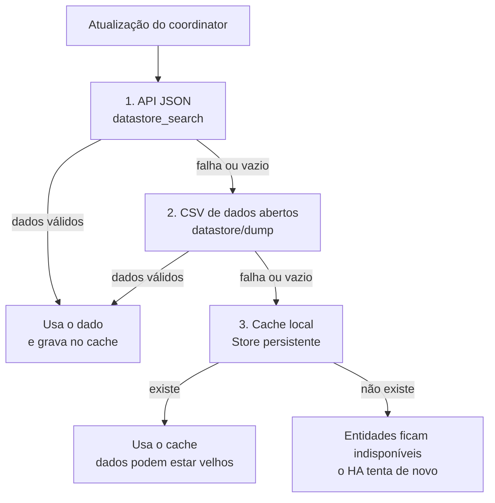

# Tarifas ANEEL — integração para o Home Assistant

[](https://hacs.xyz/)

[](LICENSE)

Consulta TUSD, TE e bandeiras tarifárias da ANEEL e mostra quanto você paga
por kWh, já com os impostos da sua conta de luz.
Funciona com o painel de Energia do Home Assistant e continua exibindo os
últimos dados conhecidos quando o portal da ANEEL fica fora do ar.

---

## 1. O que a integração faz

A integração transforma os dados públicos da ANEEL em um preço por kWh
pronto para usar no Home Assistant:

- **Tarifas oficiais**: busca TUSD e TE da sua distribuidora, subgrupo,
  classe, subclasse e modalidade tarifária.
- **Bandeira tarifária**: identifica a bandeira do mês (Verde, Amarela,
  Vermelha P1/P2 ou Escassez Hídrica) e soma o adicional ao preço.
- **Impostos da sua conta**: aplica ICMS, PIS e COFINS com a fórmula
  "por dentro" usada na fatura brasileira. O padrão é o PIS/COFINS
  calculado sobre a base **sem ICMS**.
- **Modalidade Branca**: na tarifa branca, o preço acompanha o posto do
  momento (Ponta, Intermediário ou Fora ponta).
- **Fallback em 3 camadas**: API JSON → CSV de dados abertos → cache
  local. Tarifa e bandeira são buscadas de forma independente.
- **Custo estimado do mês**: opcional, calculado a partir de um sensor de
  consumo (e, se você tiver, de um sensor de injeção).
- **Avisos no Home Assistant**: dados desatualizados e lembrete para
  revisar os impostos.

A ANEEL não publica alíquotas de ICMS, PIS ou COFINS: esses valores mudam
por estado, município e mês. Por isso a integração começa com **0%** e você
copia os valores da sua própria fatura.

---

## 2. Glossário de siglas e termos

| Sigla ou termo | Significado | Explicação simples |
|---|---|---|
| **ANEEL** | Agência Nacional de Energia Elétrica | Órgão que regula o setor elétrico e publica os dados de tarifas usados pela integração. |
| **Distribuidora / concessionária** | Empresa de distribuição de energia | Empresa que opera a rede da sua cidade e emite a sua conta de luz. |
| **TUSD** | Tarifa de Uso do Sistema de Distribuição | Parte do preço que paga pelo uso da rede elétrica. |
| **TE** | Tarifa de Energia | Parte do preço que paga pela energia em si. |
| **kWh** | Quilowatt-hora | Unidade de energia usada na sua conta. É o "quanto você consumiu". |
| **MWh** | Megawatt-hora | Mil kWh. A ANEEL publica vários valores em R$/MWh; a integração converte para R$/kWh. |
| **R$/kWh** | Reais por quilowatt-hora | Preço unitário da energia. É a unidade das entidades de tarifa. |
| **Tarifa de energia** | Preço da energia | Valor cobrado por kWh, formado por TUSD, TE, bandeira e tributos. |
| **ICMS** | Imposto sobre Circulação de Mercadorias e Serviços | Imposto estadual que aparece na conta como um percentual. |
| **PIS** | Programa de Integração Social | Contribuição federal que aparece como percentual na conta. |
| **COFINS** | Contribuição para o Financiamento da Seguridade Social | Outra contribuição federal, também percentual. |
| **CIP/COSIP** | Contribuição de Iluminação Pública | Valor fixo mensal cobrado pelo município. Não é um preço por kWh. |
| **Bandeira tarifária** | Mecanismo de adicional mensal | Quando a geração de energia fica mais cara, a ANEEL aciona uma bandeira e adiciona um valor por kWh. |
| **Bandeira Verde** | Bandeira sem adicional | Condição normal: não há acréscimo por kWh. |
| **Bandeira Amarela** | Bandeira de alerta | Tem um adicional pequeno por kWh. |
| **Bandeira Vermelha P1** | Bandeira vermelha, patamar 1 | Adicional maior que o da amarela. |
| **Bandeira Vermelha P2** | Bandeira vermelha, patamar 2 | Adicional ainda maior. |
| **Escassez Hídrica** | Bandeira extraordinária | Bandeira criada em período de crise hídrica; pode aparecer em competências antigas. |
| **Adicional de bandeira** | Valor da bandeira em R$/kWh | Quanto a bandeira vigente acrescenta ao preço. |
| **Subgrupo (B1, B2, B3)** | Grupo tarifário | Classificação da unidade consumidora. B1 é o residencial típico; B2 e B3 cobrem outras situações do grupo B. |
| **Classe** | Classe de consumo | Tipo de uso da energia: residencial, rural, iluminação pública etc. |
| **Subclasse** | Subdivisão da classe | Detalhe dentro da classe, como Residencial ou Baixa Renda. |
| **Baixa Renda** | Subclasse social | Subclasse usada por consumidores com desconto social (Tarifa Social). |
| **Modalidade Convencional** | Tarifa convencional | Um único preço por kWh, independentemente do horário. |
| **Modalidade Branca** | Tarifa branca | Preço diferente conforme o horário: ponta, intermediário e fora ponta. |
| **Posto tarifário** | Faixa de horário | Período do dia usado para escolher o preço na tarifa branca. |
| **Ponta** | Horário de pico | Período de maior consumo e preço mais alto. |
| **Intermediário** | Faixa de transição | Uma hora antes e uma hora depois da ponta, conforme a janela configurada. |
| **Fora ponta** | Fora do horário de pico | Demais horários do dia, com preço menor. |
| **Vigência** | Período de validade | Data de início e fim em que uma tarifa vale. A tarifa não é mensal: ela vale até o próximo reajuste. |
| **Competência** | Mês de referência | Mês a que um dado pertence, como a bandeira tarifária. |
| **HACS** | Home Assistant Community Store | Loja comunitária que instala integrações personalizadas no Home Assistant. |
| **HA** | Home Assistant | Plataforma de automação residencial onde a integração roda. |
| **CKAN / Dados Abertos** | Portal e API de dados públicos | Plataforma usada pela ANEEL para publicar os datasets que a integração consulta. |
| **Cache** | Cópia local dos dados | Último dado válido guardado no Home Assistant para continuar funcionando sem internet ou com o portal fora do ar. |
| **Microgeração / compensação** | Geração própria de energia | Energia injetada na rede que pode abater o consumo. A integração só considera isso se você informar um sensor de injeção. |

---

## 3. Instalação via HACS

O HACS precisa que o repositório seja **público**. Adicionar o repositório
personalizado **não instala** a integração: depois de adicionar, é preciso
fazer o **Download**.

1. Instale o [HACS](https://hacs.xyz/) no seu Home Assistant, caso ainda
   não tenha.
2. Abra **HACS → Integrações**.
3. Clique no menu de três pontos (⋮) no canto superior direito e escolha
   **Repositórios personalizados**.
4. Cole a URL do repositório:
   `https://github.com/flaviocorrea13/tarifas-aneel`
5. Selecione a categoria **Integration** e clique em **Adicionar**.
6. Ainda no HACS, procure **Tarifas ANEEL**, abra o cartão da integração e
   clique em **Download**.
7. **Reinicie o Home Assistant** (Configurações → Sistema → Reiniciar).
8. Depois do reinício, vá em **Configurações → Dispositivos e serviços →
   Adicionar integração** e procure **Tarifas ANEEL**.

> Se a integração não aparecer, confira a seção
> [Solução de problemas](#10-solução-de-problemas). O passo de **Download**
> e o **reinício** são obrigatórios.

---

## 4. Instalação manual

1. Baixe o conteúdo do repositório.
2. Copie a pasta `custom_components/tarifas_aneel` para dentro de
   `config/custom_components/` do seu Home Assistant.
3. A estrutura final deve ser exatamente esta:

   ```text
   config/
   └── custom_components/
       └── tarifas_aneel/
           ├── __init__.py
           ├── manifest.json
           ├── sensor.py
           ├── ...
           └── translations/
   ```

4. Reinicie o Home Assistant.
5. Vá em **Configurações → Dispositivos e serviços → Adicionar
   integração** e procure **Tarifas ANEEL**.

Não copie uma pasta dentro de outra (por exemplo,
`tarifas_aneel/tarifas_aneel/`). Os arquivos precisam ficar diretamente
dentro de `config/custom_components/tarifas_aneel/`.

---

## 5. Configuração

### 5.1 Adicionar a integração

Em **Configurações → Dispositivos e serviços → Adicionar integração**,
escolha **Tarifas ANEEL** e preencha o recorte tarifário:

| Campo | O que escolher |
|---|---|
| **Distribuidora** | A empresa que aparece na sua conta. Há 115 siglas; quando dois nomes ficam iguais, a sigla exata aparece entre colchetes. |
| **Subgrupo** | O subgrupo da fatura. Para residencial, normalmente **B1**. |
| **Classe** | A classe de consumo. Para residencial, **Residencial**. |
| **Subclasse** | A subclasse da fatura. Para residencial comum, **Residencial**; para Tarifa Social, escolha a opção **Baixa Renda** correspondente. |
| **Modalidade** | **Convencional** ou **Branca**. |
| **Detalhe** | **Não se aplica** no caso normal. Escolha **SCEE** apenas se a sua fatura tem TE reduzida por geração distribuída. |

O recorte é validado no portal da ANEEL antes de criar a integração. Se
não houver tarifa publicada para a combinação, o formulário avisa e a
integração não é criada.

### 5.2 Opções (options flow)

Depois de criar a integração, abra **Configurações → Dispositivos e
serviços → Tarifas ANEEL → Configurar**:

| Opção | Padrão | Para que serve |
|---|---|---|
| **ICMS (%)** | 0 | Alíquota de ICMS da sua conta. Exemplo de preenchimento: `18`. |
| **PIS (%)** | 0 | Alíquota de PIS. Exemplo: `0,65`. |
| **COFINS (%)** | 0 | Alíquota de COFINS. Exemplo: `3,64`. |
| **PIS/COFINS calculado sem ICMS na base** | Ligado | Usa a fórmula recomendada, em que o PIS/COFINS incide sobre a base sem ICMS. Desligue apenas se quiser reproduzir a fórmula antiga. |
| **CIP/COSIP (R$/mês)** | 0 | Valor fixo mensal da iluminação pública. É informativo e **não** entra no R$/kWh. |
| **Intervalo de atualização (h)** | 12 | De quanto em quanto tempo a ANEEL é consultada. Mínimo de 6 horas. |
| **Sensor de consumo (kWh)** | — | Opcional. Habilita o sensor de **custo estimado no mês**. |
| **Sensor de injeção (kWh)** | — | Opcional. Usado para descontar a energia injetada na rede no custo estimado. |
| **Início/Fim da ponta** | 17:30 / 20:30 | Só aparece na modalidade Branca. Ajuste para a janela da sua distribuidora. |

Toda vez que você salva as opções, a data da revisão das alíquotas é
registrada no atributo `aliquotas_revisadas_em` dos sensores de tarifa.

### 5.3 Onde encontrar os impostos na conta de luz

Procure na fatura a tabela **Tributo/Alíquota** (às vezes chamada de
"Informação dos tributos" ou "Composição da tarifa"). Dela saem:

- **ICMS**: alíquota estadual, em percentual.
- **PIS**: alíquota federal, em percentual.
- **COFINS**: alíquota federal, em percentual.
- **CIP/COSIP**: valor em reais cobrado pelo município, normalmente em
  "Outros itens" ou "Itens não tarifários".

Copie os valores exatamente como estão na conta. **Não invente nem
reaproveite alíquotas de outra cidade ou de outro mês**: ICMS, PIS, COFINS
e CIP/COSIP variam por estado, município e mês.

### 5.4 Fórmula usada no cálculo

Com a opção padrão ligada, o preço com tributos é:

```text
preço final = tarifa / ((1 - ICMS) * (1 - PIS - COFINS))
```

As alíquotas são usadas em fração: 17% vira `0,17`, 1,65% vira `0,0165`
e 7,6% vira `0,076`.

Exemplo apenas para conferir a conta: uma tarifa de `0,98660` R$/kWh com
ICMS de 17%, PIS de 1,65% e COFINS de 7,6% resulta em aproximadamente
`1,3098` R$/kWh.

Com a opção desligada, a integração usa a fórmula antiga:

```text
preço final = tarifa / (1 - (ICMS + PIS + COFINS))
```

A validação do formulário exige `0% ≤ ICMS < 100%` e
`0% ≤ PIS + COFINS < 100%`. Na fórmula antiga, a soma dos três também
precisa ser menor que 100%.

Quando ICMS, PIS e COFINS estão todos em zero, os sensores de tarifa
exibem `impostos_configurados: false` e o valor mostrado é a tarifa sem
impostos.

### 5.5 Lembrete de revisão dos impostos

A integração abre um **Repair issue não bloqueante** quando:

- a data de início de vigência da tarifa mudou (novo reajuste); ou
- passaram mais de **60 dias** desde a última revisão das alíquotas.

O texto do aviso é:

> Confira ICMS, PIS, COFINS e CIP/COSIP na sua conta de luz e atualize nas
> opções.

Salvar o options flow registra a data da revisão e encerra o lembrete. O
aviso não impede o funcionamento da integração.

---

## 6. Entidades

Cada integração cria um dispositivo **Tarifas ANEEL**. Os nomes abaixo são
os nomes das entidades; o prefixo do `entity_id` varia conforme o nome do
dispositivo.

| Entidade | Tipo | Unidade | Descrição | Principais atributos |
|---|---|---|---|---|
| `sensor..._tarifa_final` | Numérico | R$/kWh | **Preço final** com impostos e bandeira. É a entidade recomendada para o painel de Energia. | `fonte_dado`, `posto_tarifario`, `tarifa_por_posto` (Branca), `aliquotas_aplicadas`, `impostos_configurados`, `aliquotas_revisadas_em`, `pis_cofins_sem_icms`, `data_competencia` |
| `sensor..._tarifa_sem_impostos` | Numérico | R$/kWh | TUSD + TE, antes de impostos e bandeira. | `fonte_dado`, `aliquotas_aplicadas`, `impostos_configurados`, `aliquotas_revisadas_em`, `pis_cofins_sem_icms` |
| `sensor..._tarifa_tusd` | Numérico | R$/kWh | TUSD do posto ativo. | `fonte_dado`, `aliquotas_aplicadas`, `data_competencia` |
| `sensor..._tarifa_te` | Numérico | R$/kWh | TE do posto ativo. | `fonte_dado`, `aliquotas_aplicadas`, `data_competencia` |
| `sensor..._adicional_bandeira` | Numérico | R$/kWh | Adicional da bandeira vigente. | `fonte_dado`, `data_competencia` |
| `sensor..._bandeira_tarifaria` | Texto | — | Nome da bandeira (Verde, Amarela, Vermelha P1/P2, Escassez Hídrica). | `bandeira`, `adicional_rsmwh`, `adicional_rskwh`, `mes_anterior`, `consultado_em` |
| `sensor..._posto_tarifario` | Texto | — | Posto ativo no momento. Criado apenas na modalidade Branca. | `fonte_dado` |
| `sensor..._cip_cosip_mensal` | Monetário | R$/mês | CIP/COSIP configurada. Não entra no R$/kWh. | — |
| `sensor..._custo_estimado_mes` | Monetário | R$/mês | Estimativa: consumo líquido × tarifa final + CIP/COSIP. Criado apenas se houver sensor de consumo. | `consumo_kwh`, `injecao_kwh`, `consumo_liquido_kwh`, `tarifa_final`, `cip_cosip_mensal`, `compensacao_considerada` |
| `binary_sensor..._dados_desatualizados` | Problema (ligado/desligado) | — | Ligado quando a última atualização real tem mais de **3 dias** ou nunca chegou dado real. | `fonte_dado` |
| `button..._atualizar_agora` | Botão | — | Força uma atualização imediata do coordinator. | — |

Os sensores de preço usam `state_class: measurement` e unidade
`BRL/kWh`, sem `device_class`, para que o painel de Energia trate o valor
como preço pontual. Os sensores de custo mensal usam
`device_class: monetary`.

### 6.1 Custo estimado do mês

O sensor de custo estimado só é criado quando você informa um **sensor de
consumo** nas opções. O cálculo é:

```text
consumo_líquido = max(consumo - injeção, 0)
custo_estimado = consumo_líquido * tarifa_final + CIP/COSIP
```

O sensor de consumo deve representar o **consumo do mês** (por exemplo, um
`utility_meter` com ciclo mensal). Se você não informar um sensor de
injeção, a integração **não considera compensação de microgeração** — o
custo é calculado sobre o consumo inteiro.

---

## 7. Fallback em 3 camadas

Tarifa e bandeira são buscadas separadamente. Cada uma tenta as camadas
nesta ordem:

1. **API JSON oficial** — `datastore_search`, com filtros no servidor.
2. **CSV de dados abertos** — `datastore/dump`, com os mesmos filtros.
3. **Cache local persistente** — último dado válido guardado com `Store`,
   que sobrevive a reinícios do Home Assistant.



Na bandeira, cada camada tenta primeiro o **mês corrente** e, se a ANEEL
ainda não publicou, o **mês anterior**. Quando isso acontece, o atributo
`mes_anterior` fica `true`.

O **binary sensor de dados desatualizados** resume a saúde do dado:

- **Desligado**: a última atualização real (API ou CSV) tem até 3 dias.
- **Ligado**: a última atualização real tem mais de 3 dias, ou nunca
  chegou dado real. Os valores podem vir só do cache.

Se o dado real ficar mais de **7 dias** sem voltar, a integração também
abre um Repair issue de cache antigo. Ele fecha sozinho quando a ANEEL
responde de novo.

---

## 8. Como usar a `tarifa_final` no painel de Energia

1. Confirme que a moeda do Home Assistant é **BRL** em
   **Configurações → Sistema → Geral → Moeda**.
2. Abra o **Painel de Energia**.
3. Clique em **Definir tarifas** (ou no ícone de configuração do painel).
4. Escolha a entidade `sensor..._tarifa_final` como preço da energia.
5. Salve.

O painel multiplica o consumo medido (kWh) pelo preço atual (R$/kWh). Na
modalidade Branca, a entidade acompanha o posto ativo; os demais postos
ficam disponíveis no atributo `tarifa_por_posto`.

**O que entra no R$/kWh:** TUSD + TE + adicional de bandeira, com o
gross-up de ICMS, PIS e COFINS.

**O que não entra:** CIP/COSIP (custo fixo mensal, sensor separado),
iluminação pública, multas, juros, demandas de Grupo A e outros itens não
tarifários da fatura.

---

## 9. Exemplos de automação

Os `entity_id` abaixo são exemplos. Ajuste para os IDs da sua instalação
(veja em **Configurações → Dispositivos e serviços → Entidades**).

### 9.1 Avisar quando a bandeira ficar vermelha

```yaml
alias: "Tarifas ANEEL — bandeira vermelha"
description: "Notifica quando a bandeira mudar para Vermelha P1 ou P2."
trigger:
  - platform: state
    entity_id: sensor.tarifas_aneel_bandeira_tarifaria
    to:
      - "Vermelha P1"
      - "Vermelha P2"
action:
  - service: notify.notify
    data:
      title: "Bandeira vermelha na conta de luz"
      message: >-
        A bandeira mudou para
        {{ states('sensor.tarifas_aneel_bandeira_tarifaria') }}.
        O adicional é de R$
        {{ state_attr('sensor.tarifas_aneel_bandeira_tarifaria', 'adicional_rskwh') }}
        por kWh.
mode: single
```

### 9.2 Alertar se os dados ficarem desatualizados

```yaml
alias: "Tarifas ANEEL — dados desatualizados"
description: "Avisa quando a integração ficar 6 horas com dados só de cache."
trigger:
  - platform: state
    entity_id: binary_sensor.tarifas_aneel_dados_desatualizados
    to: "on"
    for: "06:00:00"
action:
  - service: persistent_notification.create
    data:
      title: "Tarifas ANEEL desatualizadas"
      message: >-
        A integração está usando dados em cache há mais de 3 dias.
        Verifique a conexão e o portal da ANEEL. O botão "Atualizar agora"
        força uma nova tentativa.
mode: single
```

---

## 10. Solução de problemas

### 10.1 A integração não aparece em "Adicionar integração"

Siga esta ordem:

1. **Você fez o Download?** Adicionar o repositório personalizado no HACS
   só o cadastra. Abra o cartão **Tarifas ANEEL** no HACS e clique em
   **Download**.
2. **Você reiniciou o Home Assistant?** O HA só carrega integrações novas
   depois de um reinício completo (Configurações → Sistema → Reiniciar).
3. **A pasta está no lugar certo?** Confirme a existência de
   `config/custom_components/tarifas_aneel/manifest.json`. Não pode haver
   uma pasta `tarifas_aneel` dentro de outra.
4. **O repositório está público?** O HACS exige repositório público para
   integrações. Se ele estiver privado, o HACS não consegue baixar.
5. **Veja os logs.** Em **Configurações → Sistema → Logs**, filtre por
   `tarifas_aneel`. Erros de manifesto, import ou versão do HA aparecem
   ali.
6. **Atualize a página.** Às vezes o navegador mantém a lista antiga de
   integrações em cache. Recarregue com `Ctrl + F5`.

Se o log mostrar algo como `Unable to import custom_component` ou
`Manifest` inválido, copie a mensagem e abra uma issue no repositório.

### 10.2 Os dados estão em cache

O `binary_sensor..._dados_desatualizados` fica **ligado** quando a última
atualização real tem mais de 3 dias. Isso pode acontecer por:

- internet ou DNS do Home Assistant com problema;
- portal da ANEEL fora do ar ou lento;
- bloqueio de firewall para `dadosabertos.aneel.gov.br`.

O que fazer:

1. Clique no botão **Atualizar agora**.
2. Confira a conexão do Home Assistant.
3. Aguarde o próximo ciclo (12 h por padrão, ou o intervalo configurado).
4. Se o aviso persistir por mais de 7 dias, a integração abre um Repair
   issue de cache antigo.

Os valores em cache são os últimos válidos. Eles não são recalculados com
uma tarifa nova até a ANEEL responder.

### 10.3 Os valores são diferentes da conta de luz

Isso é esperado em alguns casos. Confira:

- **Impostos em zero**: a integração começa com ICMS, PIS e COFINS em 0%.
  Se você não preencheu, o preço exibido é a tarifa sem impostos. Veja o
  atributo `impostos_configurados`.
- **Alíquotas desatualizadas**: ICMS, PIS, COFINS e CIP/COSIP variam por
  estado, município e mês. Copie os valores da conta atual e salve as
  opções.
- **Fórmula do PIS/COFINS**: a opção padrão calcula o PIS/COFINS sobre a
  base sem ICMS. Se você desligou, o resultado fica maior.
- **CIP/COSIP**: não entra no R$/kWh. Ela aparece em um sensor separado,
  em R$/mês.
- **A fatura cobre dois meses**: a conta de luz pode se referir a um
  período de leitura de cerca de 30 dias que atravessa dois meses e pode
  mostrar uma bandeira diferente da atual. A integração mostra a bandeira
  da competência vigente, não a da fatura antiga.
- **Bandeira do mês anterior**: se a ANEEL ainda não publicou a bandeira
  do mês corrente, a integração usa a do mês anterior e marca
  `mes_anterior: true`. Isso pode diferenciar do valor da conta.
- **Outros itens da fatura**: iluminação pública, multas, juros, serviços
  extras, demanda de Grupo A e impostos com benefício fiscal não fazem
  parte do preço por kWh.
- **Modalidade Branca**: o preço muda conforme o posto do momento. A conta
  pode ter usado outra janela de ponta; ajuste **Início/Fim da ponta**.
- **Consumo x demanda**: o painel de Energia usa kWh. Faturas de Grupo A
  também cobram demanda (kW), que não é considerada aqui.
- **Microgeração**: sem um sensor de injeção configurado, a compensação
  não é considerada no custo estimado.

Se depois de conferir tudo o valor continuar estranho, exporte o
diagnóstico em **Configurações → Dispositivos e serviços → Tarifas ANEEL
→ ⋮ → Exportar diagnósticos** e abra uma issue com o arquivo e o trecho
da conta (sem dados pessoais).

### 10.4 Testar o fallback (opcional, para diagnóstico)

Para ver as camadas funcionando, use o botão **Atualizar agora** e confira
`fonte_dado` nos atributos:

- **API**: tudo normal.
- **CSV**: a camada JSON falhou, mas o CSV respondeu.
- **Cache**: as duas fontes online falharam; o valor veio do cache.

Uma forma prática de simular é bloquear temporariamente
`dadosabertos.aneel.gov.br` no roteador, firewall ou DNS. Bloqueie apenas
o caminho `/api/3/action/datastore_search` para testar a camada CSV;
bloqueie também `/datastore/dump` para testar o cache. Não é necessário
apagar arquivos de `.storage`; evite mexer nessa pasta com o Home
Assistant ligado.

---

## 11. Aviso importante

Esta integração usa dados públicos da **ANEEL** e os valores que você
informa da sua conta. Os resultados são **informativos** e servem para
acompanhar tendências, comparar bandeiras e alimentar o painel de Energia.

Ela **não substitui a conta de luz**, não emite fatura e não garante que o
valor final seja idêntico ao da distribuidora. A fatura pode incluir
impostos com benefícios, ajustes, multas, juros, demanda, iluminação
pública e outras particularidades que não fazem parte do preço por kWh.

Em caso de divergência, vale sempre o valor cobrado pela distribuidora e
homologado pela ANEEL.

---

## 12. Contribuição

Contribuições são bem-vindas:

1. Abra uma issue descrevendo o problema ou a sugestão.
2. Faça um fork do repositório.
3. Crie uma branch com a sua alteração.
4. Rode os testes e o lint:

   ```bash
   pip install homeassistant==2024.10.0 pytest python-dateutil pyyaml
   pytest tests -q

   pip install ruff
   ruff check custom_components tests
   ```

5. Abra um pull request explicando o que mudou e como validar.

O CI roda ruff, hassfest e a validação do HACS a cada push/PR, além dos
testes no Python 3.12 com o Home Assistant 2024.10.

---

## 13. Licença

Distribuído sob a licença **MIT**. Veja [LICENSE](LICENSE).
